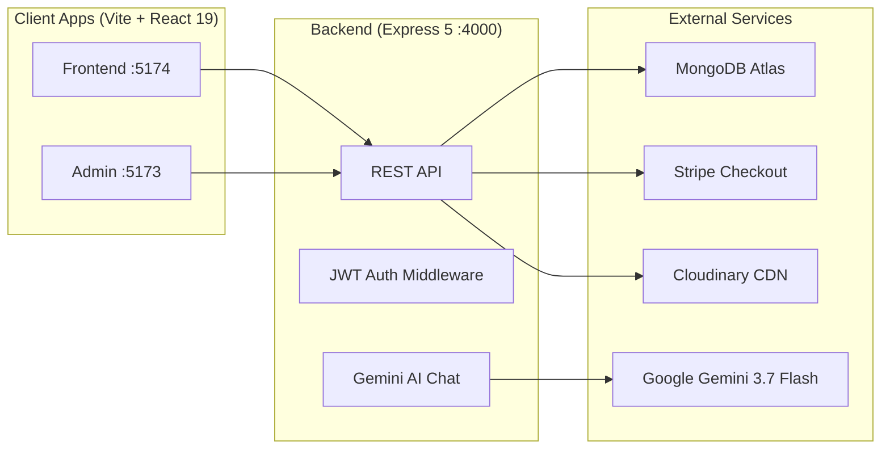
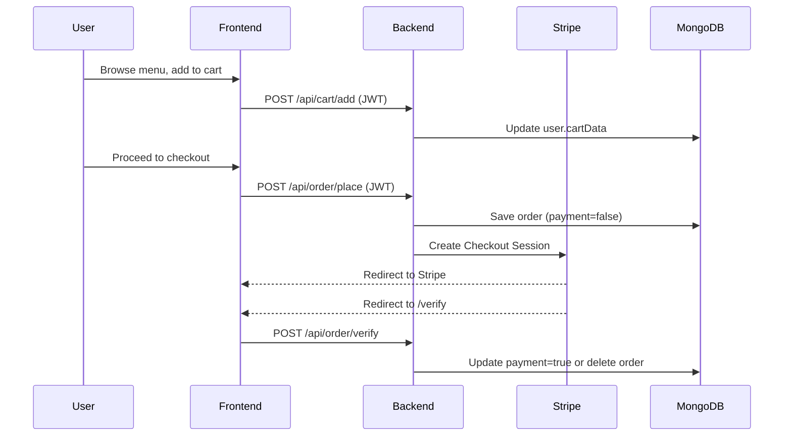

# 🍔 Tomato — Food Delivery App: Project Analysis

## Overview

A **full-stack MERN food delivery application** with three separate modules: customer-facing frontend, admin dashboard, and a Node.js/Express backend. It includes Stripe payments, JWT auth, Cloudinary image hosting, and a Gemini-powered AI food recommendation chatbot.

---

## Architecture

---

## Tech Stack

| Layer | Technology | Version |
|---|---|---|
| Frontend | React + Vite | React 19.2, Vite 8 |
| Admin Panel | React + Vite | React 19.2, Vite 8 |
| Backend | Express.js | Express 5.2 |
| Database | MongoDB (Mongoose) | Mongoose 9.7 |
| Payments | Stripe Checkout | Stripe 22.2 |
| Auth | JWT (jsonwebtoken) | 9.0 |
| Image Storage | Cloudinary + Multer | Cloudinary 2.11 |
| AI Assistant | Google Gemini | @google/genai 2.21 |
| HTTP Client | Axios | 1.17 |

---

## Project Structure

### Backend — [`backend/`](file:///Users/abhashar/PLX-C2/Food-Delevery/backend)

| File/Dir | Purpose |
|---|---|
| [`server.js`](file:///Users/abhashar/PLX-C2/Food-Delevery/backend/server.js) | Express app entry point, mounts all routes |
| [`config/db.js`](file:///Users/abhashar/PLX-C2/Food-Delevery/backend/config/db.js) | MongoDB Atlas connection |
| [`config/cloudinary.js`](file:///Users/abhashar/PLX-C2/Food-Delevery/backend/config/cloudinary.js) | Cloudinary SDK configuration |
| [`config/uploadToCloudinary.js`](file:///Users/abhashar/PLX-C2/Food-Delevery/backend/config/uploadToCloudinary.js) | Stream-based image upload utility |
| [`middleware/auth.js`](file:///Users/abhashar/PLX-C2/Food-Delevery/backend/middleware/auth.js) | JWT token verification middleware |
| [`models/userModel.js`](file:///Users/abhashar/PLX-C2/Food-Delevery/backend/models/userModel.js) | User schema (name, email, password, address, cartData) |
| [`models/foodModels.js`](file:///Users/abhashar/PLX-C2/Food-Delevery/backend/models/foodModels.js) | Food schema (name, description, price, image, category) |
| [`models/orderModel.js`](file:///Users/abhashar/PLX-C2/Food-Delevery/backend/models/orderModel.js) | Order schema (userId, items, amount, status, payment) |
| [`controlers/`](file:///Users/abhashar/PLX-C2/Food-Delevery/backend/controlers) | Business logic for user, food, cart, order, and AI |
| [`routes/`](file:///Users/abhashar/PLX-C2/Food-Delevery/backend/routes) | Route definitions for all 5 domains |

### Frontend — [`frontend/src/`](file:///Users/abhashar/PLX-C2/Food-Delevery/frontend/src)

| Component/Page | Purpose |
|---|---|
| [`context/StoreContext.jsx`](file:///Users/abhashar/PLX-C2/Food-Delevery/frontend/src/context/StoreContext.jsx) | Global state — cart, food list, auth, API URL |
| `components/Navbar` | Top navigation bar with search |
| `components/LoginPopup` | Modal for login/register |
| `components/FoodDisplay` & `FoodItem` | Food grid and individual food cards |
| `components/ExploreMenu` | Category-based menu exploration |
| `components/AIAssistant` | Gemini-powered chatbot widget |
| `components/ProtectedRoute` | Auth guard for protected pages |
| `pages/Home` | Landing page with menu, header, food display |
| `pages/Cart` | Shopping cart with totals |
| `pages/PlaceOrder` | Checkout with delivery address form |
| `pages/Verify` | Stripe payment verification callback |
| `pages/MyOrders` | Order history & tracking |
| `pages/Profile` | User profile page |

### Admin Panel — [`admin/src/`](file:///Users/abhashar/PLX-C2/Food-Delevery/admin/src)

| Page | Purpose |
|---|---|
| `pages/Add` | Add new food items (with image upload) |
| `pages/List` | View/delete food items |
| `pages/Orders` | View all orders, update status |
| `components/Navbar` + `Sidebar` | Admin layout |

---

## API Endpoints

| Method | Endpoint | Auth | Controller |
|---|---|---|---|
| `POST` | `/api/user/register` | ❌ | Register new user |
| `POST` | `/api/user/login` | ❌ | Login, returns JWT |
| `GET` | `/api/user/profile` | ✅ | Get user profile |
| `POST` | `/api/food/add` | ❌ | Add food item (multipart) |
| `GET` | `/api/food/list` | ❌ | List all food items |
| `POST` | `/api/food/remove` | ❌ | Delete food item |
| `POST` | `/api/cart/add` | ✅ | Add item to cart |
| `POST` | `/api/cart/remove` | ✅ | Remove item from cart |
| `POST` | `/api/cart/get` | ✅ | Get user's cart |
| `POST` | `/api/order/place` | ✅ | Place order → Stripe session |
| `POST` | `/api/order/verify` | ❌ | Verify Stripe payment |
| `POST` | `/api/order/userorders` | ✅ | Get user's orders |
| `GET` | `/api/order/list` | ❌ | List all orders (admin) |
| `POST` | `/api/order/status` | ❌ | Update order status |
| `POST` | `/api/ai/chat` | ❌ | AI food recommendation chat |

---

## Key Data Flow

---

## 🐛 Bugs & Issues Found

### 🔴 Critical

| # | Issue | File | Line | Details |
|---|---|---|---|---|
| 1 | **Duplicate route registration** | [`server.js`](file:///Users/abhashar/PLX-C2/Food-Delevery/backend/server.js#L28-L32) | 28 & 32 | `app.use("/api/user", userRouter)` is registered **twice**. The second mount on L32 is redundant and could cause double-execution of user route handlers. |
| 2 | **Auth middleware sets `req.userId` but controllers read `req.body.userId`** | [`auth.js`](file:///Users/abhashar/PLX-C2/Food-Delevery/backend/middleware/auth.js#L17-L18) | 17-18 | The middleware sets `req.userId` (L17) with `req.body.userId` commented out (L18). But [`cartControler.js`](file:///Users/abhashar/PLX-C2/Food-Delevery/backend/controlers/cartControler.js#L6) reads `req.body.userId` on L6, L13, L26, L31, L46. This mismatch means **cart operations will fail** for authenticated users since `req.body.userId` will be `undefined`. |
| 3 | **Order model missing `address` field** | [`orderModel.js`](file:///Users/abhashar/PLX-C2/Food-Delevery/backend/models/orderModel.js) | — | The `placeOrder` controller saves `address: req.body.address`, but the Order schema has **no `address` field** defined. With Mongoose strict mode, the address data is silently dropped. |
| 4 | **No auth on admin endpoints** | [`orderRoute.js`](file:///Users/abhashar/PLX-C2/Food-Delevery/backend/routes/orderRoute.js#L10-L11) | 10-11 | `GET /api/order/list` and `POST /api/order/status` have **no auth middleware**. Anyone can list all orders and change their status. |
| 5 | **No auth on food management** | [`foodRoute.js`](file:///Users/abhashar/PLX-C2/Food-Delevery/backend/routes/foodRoute.js#L11-L15) | 11, 15 | `POST /api/food/add` and `POST /api/food/remove` have **no auth**. Anyone can add or delete food items. |

### 🟡 Medium

| # | Issue | File | Details |
|---|---|---|---|
| 6 | **Hardcoded frontend URL** | [`orderControler.js`](file:///Users/abhashar/PLX-C2/Food-Delevery/backend/controlers/orderControler.js#L11) | `const frontened_url = 'http://localhost:5174'` — should come from `.env` for deployment flexibility. |
| 7 | **Order `amount` typed as `Object`** | [`orderModel.js`](file:///Users/abhashar/PLX-C2/Food-Delevery/backend/models/orderModel.js#L6) | `amount` is `{type: Object}` but the controller passes a number. Should be `Number`. |
| 8 | **`date` uses `Date.now()` as default** | [`orderModel.js`](file:///Users/abhashar/PLX-C2/Food-Delevery/backend/models/orderModel.js#L8) | `Date.now()` is evaluated once at schema definition time, not per-document. Should be `Date.now` (without parentheses). |
| 9 | **Unused import** | [`cartRoute.js`](file:///Users/abhashar/PLX-C2/Food-Delevery/backend/routes/cartRoute.js#L3) | `import { get } from "mongoose"` is imported but never used. |
| 10 | **Debug `console.log` statements in production code** | [`cartControler.js`](file:///Users/abhashar/PLX-C2/Food-Delevery/backend/controlers/cartControler.js#L44-L60) | Multiple `console.log("USER ID:", ...)`, `console.log("USER DATA:", ...)` left in cart controller and auth middleware. |
| 11 | **Directory typo: `controlers`** | [`backend/controlers/`](file:///Users/abhashar/PLX-C2/Food-Delevery/backend/controlers) | Should be `controllers` (missing an `l`). Also `cartControler.js` → `cartController.js`, etc. |
| 12 | **No `.env` in admin panel** | `admin/` | Admin panel has no `.env` file — the backend API URL is likely hardcoded somewhere in the admin code. |

### 🟢 Low / Suggestions

| # | Issue | Details |
|---|---|---|
| 13 | **No rate limiting** | The AI chat endpoint (`/api/ai/chat`) has no rate limiting — vulnerable to abuse. |
| 14 | **No input sanitization** | User inputs (name, email, address) are not sanitized before storage. |
| 15 | **No CORS restrictions** | `cors()` is called with no origin whitelist — any domain can call the API. |
| 16 | **Cart stored in user document** | Cart data as an embedded Object in the User model can grow unbounded and cause document bloat. |
| 17 | **No tests** | Zero test files across all three modules. |
| 18 | **Package name typos** | Backend `package.json` has `"name": "backened"`, frontend has `"name": "frontened"`. |
| 19 | **Delivery charge is ₹2** | In [`orderControler.js`](file:///Users/abhashar/PLX-C2/Food-Delevery/backend/controlers/orderControler.js#L39) — `unit_amount: 2*100` (₹2 delivery fee) seems unrealistically low. |
| 20 | **No error HTTP status codes** | All error responses return `200 OK` with `{success: false}`. Should use proper 4xx/5xx codes. |

---

## 🔒 Security Concerns

> [!CAUTION]
> **Exposed secrets in `.env`** — The backend `.env` file contains live credentials for MongoDB Atlas, Stripe, Cloudinary, and Gemini API. These should **never** be committed to git. Verify your `.gitignore` excludes `.env` files.

> [!WARNING]
> - **Admin endpoints are completely unprotected** — no auth on food add/remove, order list, or status update
> - **No role-based access control** — there's no concept of "admin" vs "user" roles in the User model
> - **JWT token sent via custom `token` header** instead of the standard `Authorization: Bearer <token>` pattern

---

## ✅ What's Working Well

- Clean separation into 3 independent modules (frontend, admin, backend)
- React Context API used effectively for global state management
- Optimistic UI updates in cart operations (update UI first, then sync to backend)
- Cloudinary integration with stream-based uploads (memory-efficient)
- AI chatbot with dynamic menu context from MongoDB
- Stripe checkout flow with proper verify/cancel handling
- Protected routes on the frontend with auth loading state
- Well-structured README with API documentation

---

## 📊 Summary

| Metric | Value |
|---|---|
| Total modules | 3 (frontend, admin, backend) |
| Backend endpoints | 14 |
| Mongoose models | 3 (User, Food, Order) |
| Frontend pages | 6 |
| Frontend components | 11 |
| Admin pages | 3 |
| External integrations | 4 (MongoDB, Stripe, Cloudinary, Gemini) |
| Critical bugs | 5 |
| Medium issues | 7 |
| Test coverage | 0% |
